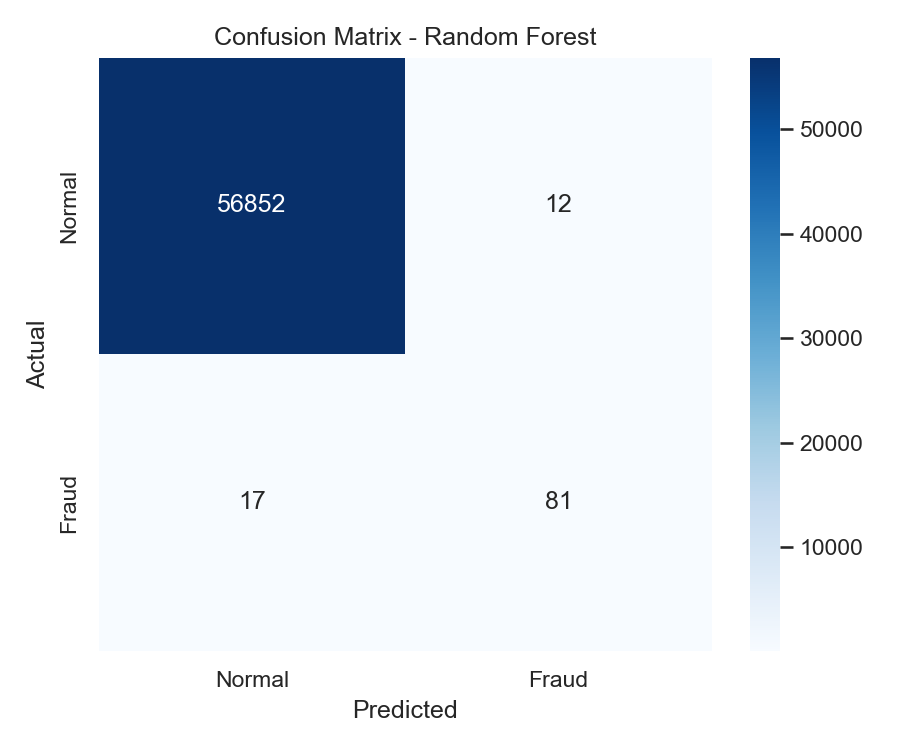
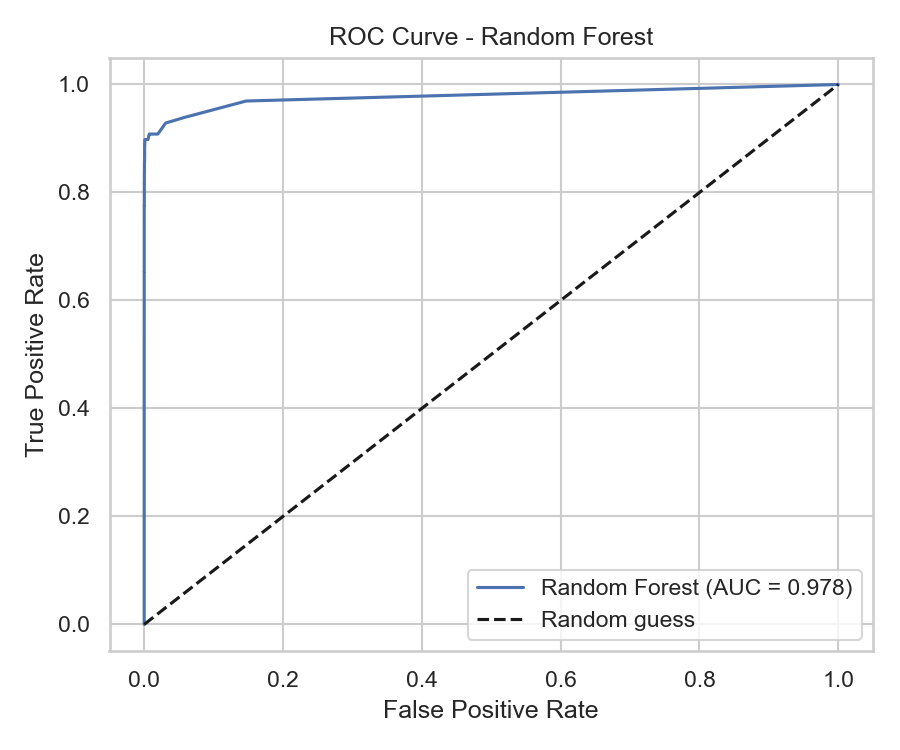
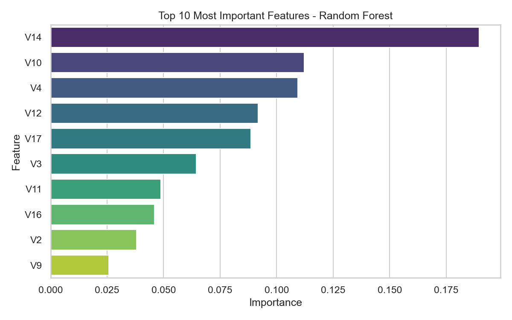
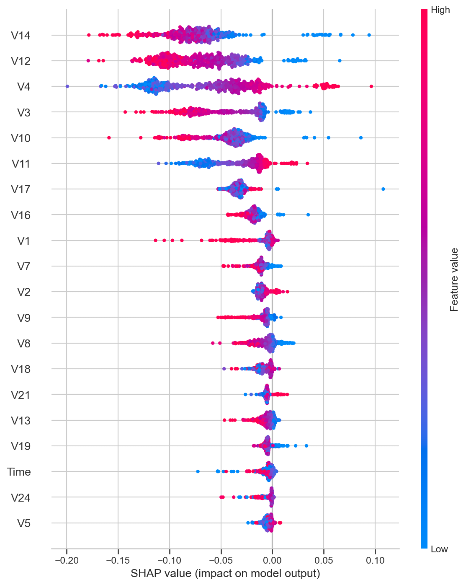

# Fraud Detection in Large-Scale Accounting Data

Machine learning project for detecting fraudulent transactions in large-scale financial/accounting data. This project applies a complete, responsible ML workflow: data preparation, model comparison, handling class imbalance, hyperparameter tuning, cross-validation, explainability, and model deployment.

## Project Overview

Fraud detection is a critical application of machine learning in accounting and auditing. This project uses a real-world, highly imbalanced credit-card transaction dataset to build and evaluate models that can automatically flag suspicious transactions.

## Dataset

- **Source:** [Credit Card Fraud Detection (Kaggle)](https://www.kaggle.com/datasets/mlg-ulb/creditcardfraud)
- **Size:** 284,807 transactions, 30 features
- **Imbalance:** Only 492 fraud cases (~0.173%)
- **Note:** The dataset (`creditcard.csv`) is not included here due to its size. Download it from the Kaggle link above and place it in the project folder.

## Methodology

1. **Data preparation** — feature scaling with StandardScaler
2. **Train/test split** — 80/20 stratified split to preserve the fraud ratio
3. **Class imbalance** — handled with SMOTE (applied to training data only)
4. **Modeling** — compared Logistic Regression, Random Forest, and XGBoost
5. **Evaluation** — accuracy, precision, recall, F1-score, ROC-AUC
6. **Optimization** — hyperparameter tuning with GridSearchCV
7. **Validation** — 5-fold stratified cross-validation
8. **Explainability** — SHAP analysis
9. **Deployment** — saved the model with joblib for reuse on new data

## Results

| Model | Accuracy | Precision | Recall | F1-Score | ROC-AUC |
|-------|----------|-----------|--------|----------|---------|
| Logistic Regression | 0.9741 | 0.0579 | 0.9184 | 0.1089 | 0.9710 |
| **Random Forest** | **0.9995** | **0.8710** | **0.8265** | **0.8482** | **0.9782** |
| XGBoost | 0.9991 | 0.6885 | 0.8571 | 0.7636 | 0.9831 |

**Best model: Random Forest** (highest F1-score, the most suitable metric for imbalanced fraud detection).

**Cross-validation:** mean F1-score of 0.860 ± 0.028 (stable and reliable).

**Key insight:** Although all models achieved very high accuracy, accuracy alone is misleading for imbalanced data. Precision, recall, and F1-score reveal the true performance differences.

## Visualizations

| Confusion Matrix | ROC Curve |
|------------------|-----------|
|  |  |

| Feature Importance | SHAP Summary |
|--------------------|--------------|
|  |  |

## How to Run

1. Clone this repository
2. Download `creditcard.csv` from Kaggle (link above) into the project folder
3. Install the required libraries:
   ```
   pip install pandas numpy scikit-learn xgboost matplotlib seaborn imbalanced-learn shap joblib
   ```
4. Open `fraud_detection.ipynb` and run all cells

## Using the Saved Model

The trained model is saved as `fraud_model.joblib` (model + scaler + feature names). To predict on new data:

```python
import joblib
import pandas as pd

bundle = joblib.load("fraud_model.joblib")
model, scaler, features = bundle["model"], bundle["scaler"], bundle["features"]

new_data = pd.read_csv("new_transactions.csv")
new_scaled = scaler.transform(new_data[features])
predictions = model.predict(new_scaled)
```

## Technologies

Python, pandas, NumPy, scikit-learn, XGBoost, imbalanced-learn (SMOTE), SHAP, matplotlib, seaborn, joblib

## License

This project is for educational purposes.
